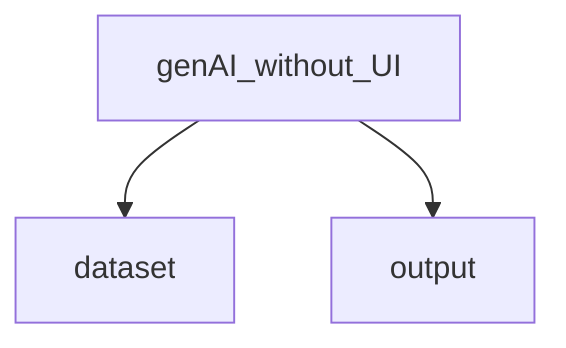

# genAI_without_UI architecture

## Source map

This diagram maps source folders/files actually present in the reviewed commit. It describes code organisation, not a verified live network topology.

## Entry points

- [Dockerfile](https://github.com/Ostrich-AI/genAI_without_UI/blob/3e78f511f4a9969fc866d358d0705b94c7eac238/Dockerfile)

## Integration and deployment context

For internal users, the wider system context is maintained in the Ostrich system-blueprints engineering hub. Public demo/installer repositories expose their own source/release context only.

Runtime calls, trust boundaries, exposed URLs, identity controls, data storage and residency must be checked against the chosen release's actual code and environment configuration before drawing security conclusions. Repository/source dependencies do not establish an enabled integration.

## Reviewed source

- [Dockerfile](https://github.com/Ostrich-AI/genAI_without_UI/blob/3e78f511f4a9969fc866d358d0705b94c7eac238/Dockerfile)
- [inference.py](https://github.com/Ostrich-AI/genAI_without_UI/blob/3e78f511f4a9969fc866d358d0705b94c7eac238/inference.py)
- [parameters.json](https://github.com/Ostrich-AI/genAI_without_UI/blob/3e78f511f4a9969fc866d358d0705b94c7eac238/parameters.json)
- [requirements.txt](https://github.com/Ostrich-AI/genAI_without_UI/blob/3e78f511f4a9969fc866d358d0705b94c7eac238/requirements.txt)

Review date: 2026-11-15. Missing topology/configuration evidence is requested through the central agency handover draft rather than separate forms.
